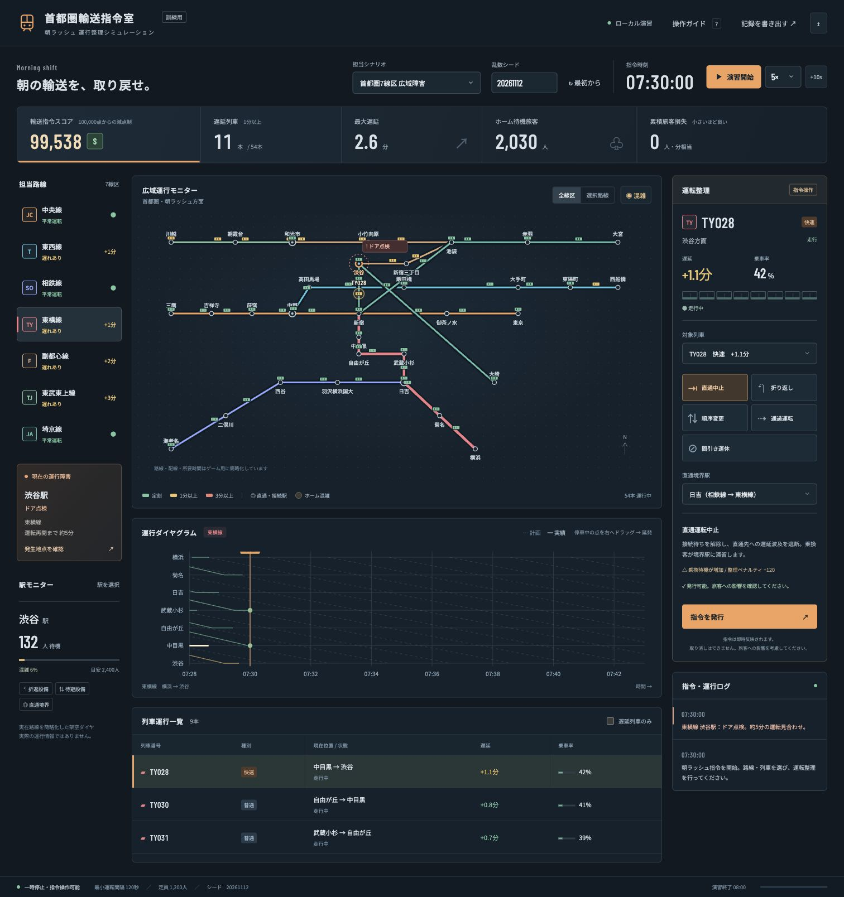

# 首都圏輸送指令室

朝ラッシュの遅延の連鎖を、輸送指令員として収束させるブラウザゲームです。
路線モニターとスジ図を見ながら運転整理を行い、旅客の待ち時間と混雑損失を抑えます。



## 起動

Node.js 22.12以降、またはNode.js 24以降を使用してください。

```sh
npm ci
npm run dev
```

[http://127.0.0.1:5173](http://127.0.0.1:5173) を開き「演習開始」を押します。
Google Cloud・APIキー・アカウントは不要です。シミュレーションと記録再生はブラウザ内で完結します。
表示用フォントはGoogle Fontsから読み込み、オフライン時はシステムフォントに切り替わります。

## 遊び方

1. シナリオを選び「最初から」で開始します。初期状態は一時停止です。
2. 路線・在線列車・駅を選び、遅延と混雑を確認します。
3. 右の指令卓で整理方法と対象を選び「指令を発行」を押します。適用できない指令には理由が表示されます。
4. 再生速度を1・5・15・60倍に変更できます。「+10s」で段階的な確認も可能です。
5. 演習終了時にS/A/B/C/F評価が表示されます。乱数シードと操作履歴をJSONで保存・再現できます。

`Space`：再生・一時停止。`?`：操作ガイド。
スジ図の停車点を右にドラッグすると、選択列車を10〜300秒延発できます。
小さい画面ではパネルが縦に並び、路線図は横スクロールできます。

## 実装した機能

- 中央線単独20分、中央・東西線直通25分、首都圏7線区30分の3シナリオ。
- 中央・東西・相鉄・東横・副都心・東武東上・埼京の7線区、32駅、最大378本の設定ダイヤ。
- 実到着時刻、動的停車時間、120秒ヘッドウェイ、直通接続待ちによるMax-Plus型の出発制約。
- 駅間抑止、ホーム占有、旅客流入・乗降・非線形な混雑損失、確率的障害。
- 直通中止、部分折り返し、順序変更、通過運転、間引き運休の5指令と、指令の適用条件検証。
- 部分折り返しによる反対方向の救済列車生成。
- 計画スジと実績スジ、列車状態、編成混雑、駅モニター、指令ログ、最終成績。
- 固定1秒刻み・シード付き乱数と時刻付き操作履歴による決定論的な記録再生。

## 検証

```sh
npm test
npm run build
npm run preview
```

Node標準テスト16件で、ヘッドウェイ・直通中止と混雑増・遅延遮断・快速先行・評価境界・
駅間抑止時の損失増・救済列車・通過時の旅客保持・運休・延発・記録再現・全シナリオ終了を検証します。
ブラウザでの確認内容と実測は [検証記録](docs/verification.md) を参照してください。

## モデルの前提と限界

実在駅を使った**架空ダイヤ・簡略配線のゲーム**です。実際の運行管理・安全判断には使用できません。
待避・折り返し設備のフラグもゲーム上の設定であり、実在駅の配線・運用を保証しません。

- 通常運行は朝ラッシュ方向の一方向。反対方向は折り返し救済列車のみをモデル化します。
- 駅間所要時間150秒、基本停車30秒、定員1,200人、最大乗車1,980人です。
- 直通は列車を物理的に同一編成で追跡せず、対応列車間の接続制約として表現します。
  中止するとこの制約を取り除き、境界駅に350人と10秒あたり16人の乗換需要を追加します。
  中止済みの接続に同じ指令を重ねることはできません。
- 旅客は駅単位で集約し、目的地別OD、乗換経路選択、全乗客の個別追跡は省略しています。
- 間引き運休時の車内旅客は次駅へ移動したものとして待機に加えます。実際の救出・回送時間は省略します。
- 快速は指令による先行対象の種別で、自動の速達停車パターンは持ちません。
- 障害はドア再開閉・急病人救護・車両点検・線路内立ち入り。天候の広域速度規制は未実装です。
- 描画は`requestAnimationFrame`で列車位置を補間し、詳細パネルは約5Hzで更新します。
  全機器での60fpsや数百駅への拡大時の性能は保証していません。
- ホーム混雑上限を超えた駅を記録・表示しますが、駅構内の入場規制人数までは分けて計算していません。

スコアは `max(0, round(100000 − 0.0007 L − 75 N − 3 Tmax − 12 C))`。
`L`は人・秒相当の累積損失、`N`は5分以上遅延した列車数、`Tmax`は最大遅延秒数、
`C`は指令ペナルティです。影響線区数は別係数に含めていません。
F評価は40,000点未満とし、ホーム混雑だけでの強制F判定は行いません。
開始時点に既にある混雑由来の遅れも最大遅延に含みます。

このリポジトリはフロントエンドと純粋JavaScriptのエンジンのみです。
ADK・gcloudの環境や認証情報は含めません。クラウドへのデプロイは行っていません。
