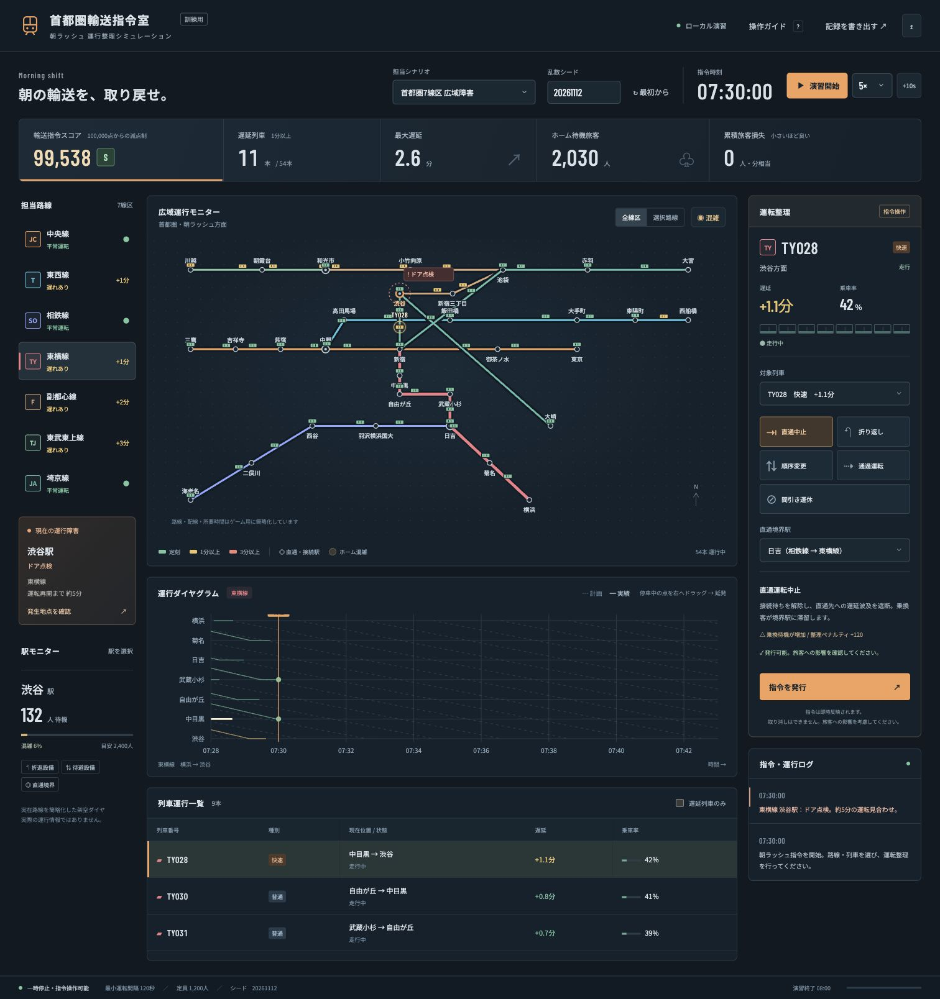
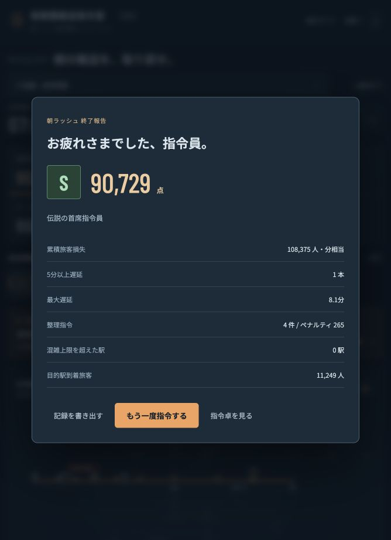

# 検証記録 — 2026-11-12

## 実行環境

macOS / Apple Silicon、Node.js v26.8.1、npm 11.19.0、Vite 8.3.8。
ブラウザ確認はCodex内ブラウザで実施。Google Cloudや推論APIは利用していない。

## 自動テスト

`npm test`：16 PASS / 0 FAIL / 0 SKIP。

- TC-001：Max-Plusの各制約、障害発生後も全駅実出発ヘッドウェイ120秒以上、後続への遅延伝播。
- TC-002：直通中止の接続解除・境界駅350人増・整理ペナルティ120、下流遅延が接続維持時より減ること。
- TC-003：快速先発、普通との安全間隔の保持。
- TC-004：90,000・75,000・60,000・40,000点の境界と減点算術。
- TC-005：駅間抑止300秒以上、定員超過時の非線形な旅客損失増。
- その他：折り返し救済列車の生成と完走、通過時に乗降しないこと、不正指令の無変更、運休時の旅客保持、延発。
- 記録再生の時刻・全列車状態・累積損失・スコア・乱数障害・ログの完全一致。
- シードとステップ分割の独立性、不正なJSON記録、3シナリオ完走、終了後の状態不変。

`npm run build`：PASS。

## ブラウザで実操作

| 操作                   | 確認結果                                                     |
| ---------------------- | ------------------------------------------------------------ |
| 7線区・渋谷の直通中止  | 指令ログ追加、駅待機132→482人、重複発行不可                  |
| シナリオ変更・リセット | 確認ダイアログを経て中央線のみの演習に切替                   |
| JC038の荻窪通過        | 指令ログに通過設定が追加                                     |
| JC040の荻窪優先        | 普通JC037に対する快速先行指令が追加                          |
| JC037の荻窪折り返し    | 部分折り返し設定が追加                                       |
| JC039の間引き運休      | 吉祥寺での振替待機としてログ追加                             |
| 60倍速で最後まで運転   | 07:50:00で停止、成績ダイアログ表示                           |
| 終了結果               | 90,729点・S、最大遅延8.1分、4指令、旅客損失108,375人・分相当 |
| JSON書き出し・読み込み | 07:50:00 / 90,729点の同じ状態を再現                          |
| スジ図の停車点ドラッグ | JC037の80秒延発がログに反映                                  |
| 操作ガイド             | 開閉と説明表示を確認                                         |
| コンソール             | 確認時点でerror・warnなし                                    |
| 幅1512px               | ページ幅1512px、ページ全体の横はみ出しなし                   |
| 幅390px                | ページ幅390px、パネル縦配置、路線網は内部横スクロール        |

ドラッグ検証で、現在時刻のSVG線が停車点へのポインター入力を遮る不具合を発見。
線・背景・計画スジのpointer-eventsを無効化し、同じドラッグを再実行して延発成功を確認した。

スマートフォン表示の記録：[幅390pxの画面](dispatch-mobile.jpg)。

## 計算処理の参考実測

乱数障害を無効化し、初期化後の全時間を同期処理で進めた単発実測。
ブラウザのFPSやモバイル機器の速度を示す値ではない。

| シナリオ   | 設定列車 |  駅 | 全時間を進める処理 |
| ---------- | -------: | --: | -----------------: |
| 単線区20分 |       54 |   7 |              約9ms |
| 直通25分   |      108 |  12 |             約20ms |
| 7線区30分  |      378 |  32 |            約107ms |

## 未検証・残る範囲

- 実機スマートフォン、Safari、Firefoxでの挙動。
- 継続的な60fps、100駅以上への拡大時の性能。
- 全ての指令の組合せに対するゲームバランスと長期的な攻略可能性。
- 実際の鉄道設備・信号閉塞・旅客OD・実ダイヤとの整合。

仕様からの簡略化はREADMEの「モデルの前提と限界」を参照。
